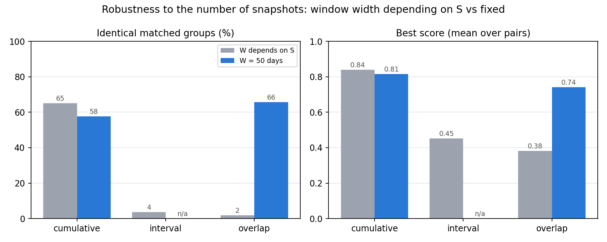
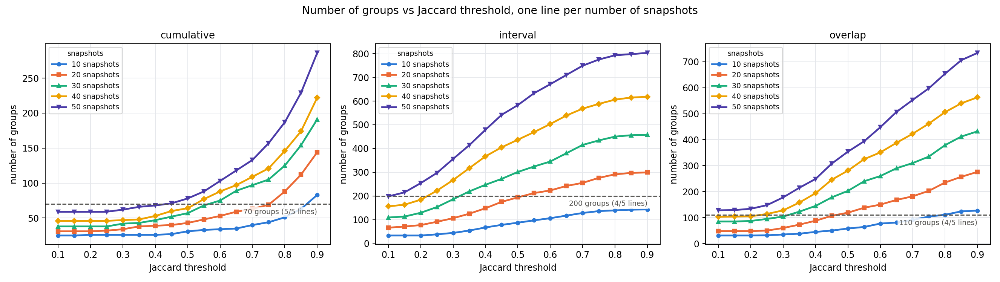
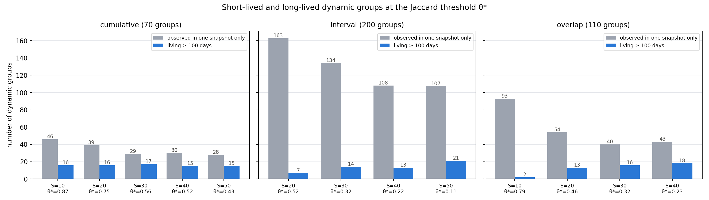
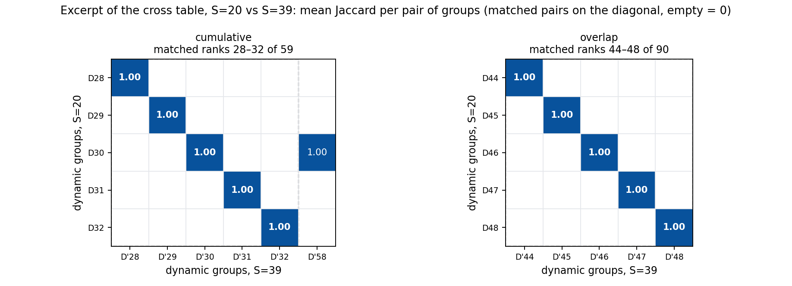
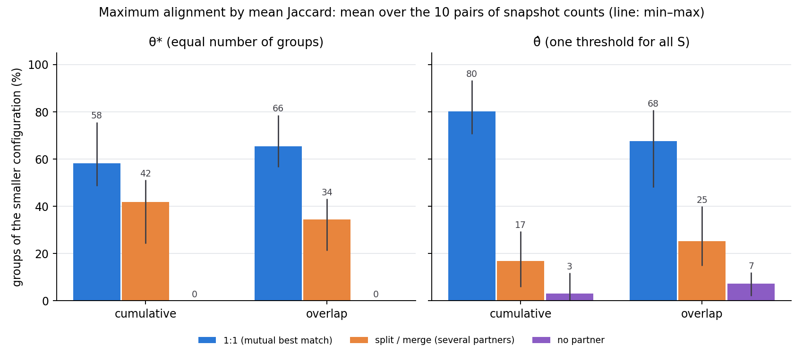
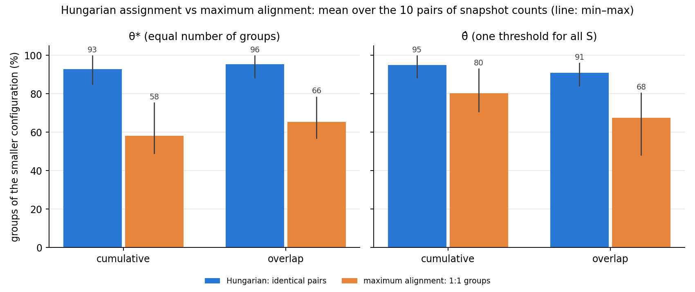

# Sensitivity analysis: Jaccard threshold and number of snapshots

Notes on the sensitivity analysis of dynamic-group identification.
All results use the **absolute Jaccard** matching criterion (a community in
snapshot t inherits the identity of a community in snapshot t-1 when their
Jaccard similarity is at least the threshold).

- Data: `number_of_groups.csv` (written by `scripts/config_sensitivity.py`).
- Figures: `scripts/sensitivity_plots.py` -> `figures/`
- Grid: approaches cumulative / interval / overlap, snapshot counts 10, 20, 30,
  40, 50, Jaccard thresholds 0.10 to 0.90 in steps of 0.05.

## Number of groups vs Jaccard threshold, one line per snapshot count

Figure: `figures/groups_vs_jaccard_by_snapshots.png`

One subplot per approach. x axis: Jaccard threshold, y axis: number of groups,
one line per number of snapshots (10 to 50). A horizontal dashed line marks a
round number of groups chosen close to the value that intercepts the most
lines; the intersections give, per snapshot count, the Jaccard threshold that
yields that many groups.

### Observations

- For every approach and snapshot count the number of groups grows
  monotonically with the Jaccard threshold: a stricter threshold breaks more
  chains, so more distinct groups are produced.
- More snapshots always give more groups at the same threshold. The lines never
  cross: the 50-snapshot line lies above the 40-snapshot line, and so on.
- Cumulative is the least sensitive approach (25 to 286 groups over the whole
  grid); interval is the most sensitive (33 to 803 groups).
- Only the cumulative approach has a number of groups reachable by all five
  snapshot counts (any value between 59 and 83). For interval and overlap the
  10-snapshot line stays below the lowest value of the 50-snapshot line, so no
  single group count intercepts all five lines.

### Dashed line and intersections

Jaccard threshold at which each snapshot-count line reaches the dashed value
(linear interpolation between the two neighbouring grid points).

| approach   | dashed line | lines intercepted | 10 snap. | 20 snap. | 30 snap. | 40 snap. | 50 snap. |
|------------|-------------|-------------------|----------|----------|----------|----------|----------|
| cumulative | 70 groups   | 5 of 5            | 0.87     | 0.75     | 0.56     | 0.52     | 0.43     |
| interval   | 200 groups  | 4 of 5            | never (max 143) | 0.52 | 0.32 | 0.22 | 0.11 |
| overlap    | 110 groups  | 4 of 5            | 0.79     | 0.46     | 0.32     | 0.23     | never (min 128) |

- Interval at 200 groups: the 10-snapshot run peaks at 143 groups at Jaccard
  0.90, so it never reaches 200.
- Overlap at 110 groups: the 50-snapshot run already starts at 128 groups at
  Jaccard 0.10, so it never comes down to 110. Any value from 103 (minimum of
  the 40-snapshot line) to 127 (maximum of the 10-snapshot line) intercepts
  4 of 5 lines; 110 is the round value inside that window.
- Reading across a row: to keep the same number of groups when the number of
  snapshots increases, the Jaccard threshold has to be lowered substantially
  (cumulative: from 0.87 at 10 snapshots to 0.43 at 50).

## The dynamic groups at the intersection thresholds

Figure: `figures/lifespan_classes_at_theta_star.png`, table: `groups_at_theta_star.csv`

For every snapshot count whose line reaches the dashed value of the previous section, the
identity matching is re-run on the cached Louvain communities at exactly the
interpolated threshold θ*. Snapshot counts whose line never reaches the dashed
value are left out (interval S = 10, overlap S = 50). The figure shows, per
snapshot count, two bars: the groups observed in one snapshot only and the groups
living at least 100 days (lifespan = days between the end of the first and the
last snapshot window of the group).

| approach   | S  | θ*    | groups | median lifespan (days) | median max size | single-snapshot groups | groups ≥ 100 days |
|------------|----|-------|--------|------------------------|-----------------|------------------------|-------------------|
| cumulative | 10 | 0.867 | 66     | 0.0                    | 58.0            | 46                     | 16                |
| cumulative | 20 | 0.753 | 71     | 0.0                    | 51.0            | 39                     | 16                |
| cumulative | 30 | 0.564 | 72     | 17.5                   | 46.0            | 29                     | 17                |
| cumulative | 40 | 0.523 | 70     | 13.2                   | 33.5            | 30                     | 15                |
| cumulative | 50 | 0.433 | 70     | 10.5                   | 27.5            | 28                     | 15                |
| interval   | 20 | 0.517 | 205    | 0.0                    | 46.0            | 163                    | 7                 |
| interval   | 30 | 0.321 | 199    | 0.0                    | 40.0            | 134                    | 14                |
| interval   | 40 | 0.221 | 196    | 0.0                    | 29.5            | 108                    | 13                |
| interval   | 50 | 0.106 | 199    | 0.0                    | 26.0            | 107                    | 21                |
| overlap    | 10 | 0.793 | 110    | 0.0                    | 54.5            | 93                     | 2                 |
| overlap    | 20 | 0.463 | 112    | 25.0                   | 54.0            | 54                     | 13                |
| overlap    | 30 | 0.316 | 109    | 17.0                   | 33.0            | 40                     | 16                |
| overlap    | 40 | 0.228 | 109    | 12.8                   | 32.0            | 43                     | 18                |

### Observations

- At θ* the number of groups lands within ±6 of the target for all configurations,
  so the interpolated thresholds are reliable.
- Cumulative: the number of long-lived groups (≥ 100 days) is almost constant
  (15 to 17) for all five snapshot counts. The groups spanning nearly the whole
  period (≥ 400 days) grow from 1 (S = 10) to 9 (S = 50): with few snapshots and a
  high θ*, long chains are broken more easily.
- The median maximum size decreases with S in every approach (cumulative 58 → 27.5,
  interval 46 → 26, overlap 54.5 → 32): with more snapshots each window covers
  less activity (interval, overlap) or more windows end early in the period
  (cumulative), so Louvain finds smaller communities, and small short-lived groups make up a
  larger share of the fixed group count.
- Interval is dominated by single-snapshot groups (more than half in every
  configuration, 82 % at S = 20), so a matching group count hides a large number of
  groups that are never continued.
- Overlap at S = 10 behaves differently from S = 20 to 40: 85 % of its groups live
  in one snapshot only and only 2 reach 100 days, whereas S = 20 to 40 give 13 to
  18 long-lived groups.
- Visually, the long-lived tail (lifespan > 100 days, size 30 to 200) is populated by
  every snapshot count in cumulative, and by S ≥ 20 in interval and overlap. The
  overall shapes are similar, which the next section checks at member level.

## Community comparison across snapshot counts

Methodology: see the section "Robustness of the dynamic groups to the number of
snapshots" in `paper_notes.md`.

Tables: `group_matching_summary.csv` (one row per pair), `group_matching_pairs.csv`
(every matched group pair with its mean Jaccard), and the full cross tables in
`crosstabs/{approach}_S{i}_vs_S{j}.csv`.

### Final table: Jaccard thresholds and the communities they produce

The hypothesis is formulated for the thresholds $\theta^*_S$ that give every snapshot
count the same number of dynamic groups $N^*$. For each pair of configurations
$(S_i, \theta^*_{S_i})$ and $(S_j, \theta^*_{S_j})$ the table reports how well the
resulting communities agree: the median and mean similarity of the one-to-one matched
groups ($\mathcal{J}_{ij}$), the share of matched groups whose chronicles are
identical on the common time points ($\bar{J} \ge 0.99$).

**cumulative** (reference level $N^* = 70$ groups): $\theta^*_{10} = 0.867$, $\theta^*_{20} = 0.753$, $\theta^*_{30} = 0.564$, $\theta^*_{40} = 0.523$, $\theta^*_{50} = 0.433$

| $(S_i, \theta^*_{S_i})$ | $(S_j, \theta^*_{S_j})$ | median $\mathcal{J}_{ij}$ | mean $\mathcal{J}_{ij}$ | identical matched groups |
|---|---|---|---|---|
| (10, 0.867) | (20, 0.753) | 1.00 | 0.81 | 59 % |
| (10, 0.867) | (30, 0.564) | 1.00 | 0.83 | 63 % |
| (10, 0.867) | (40, 0.523) | 1.00 | 0.82 | 58 % |
| (10, 0.867) | (50, 0.433) | 1.00 | 0.86 | 65 % |
| (20, 0.753) | (30, 0.564) | 1.00 | 0.82 | 70 % |
| (20, 0.753) | (40, 0.523) | 1.00 | 0.78 | 57 % |
| (20, 0.753) | (50, 0.433) | 1.00 | 0.83 | 65 % |
| (30, 0.564) | (40, 0.523) | 1.00 | 0.86 | 68 % |
| (30, 0.564) | (50, 0.433) | 1.00 | 0.90 | 76 % |
| (40, 0.523) | (50, 0.433) | 1.00 | 0.89 | 76 % |

**interval** (reference level $N^* = 200$ groups): $\theta^*_{20} = 0.517$, $\theta^*_{30} = 0.321$, $\theta^*_{40} = 0.221$, $\theta^*_{50} = 0.106$

| $(S_i, \theta^*_{S_i})$ | $(S_j, \theta^*_{S_j})$ | median $\mathcal{J}_{ij}$ | mean $\mathcal{J}_{ij}$ | identical matched groups |
|---|---|---|---|---|
| (20, 0.517) | (30, 0.321) | 0.53 | 0.52 | 1 % |
| (20, 0.517) | (40, 0.221) | 0.35 | 0.37 | 5 % |
| (20, 0.517) | (50, 0.106) | 0.33 | 0.34 | 0 % |
| (30, 0.321) | (40, 0.221) | 0.44 | 0.47 | 4 % |
| (30, 0.321) | (50, 0.106) | 0.37 | 0.35 | 2 % |
| (40, 0.221) | (50, 0.106) | 0.46 | 0.46 | 8 % |

**overlap** (reference level $N^* = 110$ groups): $\theta^*_{10} = 0.793$, $\theta^*_{20} = 0.463$, $\theta^*_{30} = 0.316$, $\theta^*_{40} = 0.228$

| $(S_i, \theta^*_{S_i})$ | $(S_j, \theta^*_{S_j})$ | median $\mathcal{J}_{ij}$ | mean $\mathcal{J}_{ij}$ | identical matched groups |
|---|---|---|---|---|
| (10, 0.793) | (20, 0.463) | 0.40 | 0.39 | 1 % |
| (10, 0.793) | (30, 0.316) | 0.30 | 0.32 | 1 % |
| (10, 0.793) | (40, 0.228) | 0.23 | 0.25 | 0 % |
| (20, 0.463) | (30, 0.316) | 0.28 | 0.32 | 1 % |
| (20, 0.463) | (40, 0.228) | 0.22 | 0.27 | 1 % |
| (30, 0.316) | (40, 0.228) | 0.33 | 0.35 | 5 % |

### Example of each approach

Figure: `figures/crosstab_example_S20_vs_S40.png` (S = 20 vs S = 40, the only pair
available for all three approaches with 20 common time points).

For each approach a small excerpt of the cross table, with the mean Jaccard written
in each cell (empty = 0). Rows: 5 consecutive groups of $\mathbb{D}_{S=20}$ around the
median matched rank, i.e. typical rather than best matches. Columns: their matched
groups of $\mathbb{D}_{S=40}$ (diagonal, inside the dashed box), followed by up to 3
other groups of $S = 40$ that share members with these rows (largest Jaccard sum).

- Cumulative (ranks 25–29 of 53): diagonal of 1.00 and no other partner at all, a
  1:1 correspondence even for a typical group.
- Interval (ranks 68–72 of 138): matched values about 0.35, plus small overlaps
  (0.04 to 0.06) with other groups.
- Overlap (ranks 39–43 of 81): matched values about 0.22, and the rows spread over
  several further groups (up to 0.07).

Partners per group (cells with Jaccard > 0 per row), over all pairs of snapshot
counts: cumulative 1.00 to 1.11, interval 4.1 to 5.0, overlap 4.3 to 6.9.

### How to read a cross table

Each file is a matrix: the rows are the dynamic groups $D_1, D_2, \ldots$ of
$\mathbb{D}_{S_i}$, the columns the dynamic groups $D'_1, D'_2, \ldots$ of
$\mathbb{D}_{S_j}$ (original group id in brackets), and each cell is the mean
Jaccard index of the two groups' member sets over the common time points
(0 at a time point where only one of the two exists). Rows and columns are ordered
by the linear sum assignment: $D_k$ is matched to $D'_k$, so the matched values
lie on the diagonal, sorted from best to worst; groups left without a partner come
last. Cells with Jaccard 0 are left empty. A clean 1:1 correspondence shows up as a
diagonal of values near 1 with empty cells elsewhere.

Excerpts (six matched pairs spread evenly from the best to the worst match; the
diagonal, in bold, is the matched value; empty cells have Jaccard 0):

**Cumulative, S = 10 vs S = 20** (`crosstabs/cumulative_S10_vs_S20.csv`, 66 × 46; showing matched ranks 1, 10, 19, 28, 37, 46 of 46)

| S=10 \\ S=20 | D'1 | D'10 | D'19 | D'28 | D'37 | D'46 |
|---|---|---|---|---|---|---|
| D1 | **1.00** |  |  |  |  |  |
| D10 |  | **1.00** |  |  |  |  |
| D19 |  |  | **1.00** |  |  |  |
| D28 |  |  |  | **0.83** |  |  |
| D37 |  |  |  |  | **0.60** |  |
| D46 |  |  |  |  | 0.30 |  |

**Interval, S = 20 vs S = 30** (`crosstabs/interval_S20_vs_S30.csv`, 117 × 93; showing matched ranks 1, 19, 38, 56, 75, 93 of 93)

| S=20 \\ S=30 | D'1 | D'19 | D'38 | D'56 | D'75 | D'93 |
|---|---|---|---|---|---|---|
| D1 | **1.00** |  |  |  |  |  |
| D19 |  | **0.75** |  |  |  |  |
| D38 |  |  | **0.60** |  |  |  |
| D56 |  |  |  | **0.48** |  |  |
| D75 |  |  |  |  | **0.35** |  |
| D93 |  |  |  |  |  |  |

**Overlap, S = 10 vs S = 20** (`crosstabs/overlap_S10_vs_S20.csv`, 110 × 83; showing matched ranks 1, 17, 34, 50, 67, 83 of 83)

| S=10 \\ S=20 | D'1 | D'17 | D'34 | D'50 | D'67 | D'83 |
|---|---|---|---|---|---|---|
| D1 | **1.00** |  |  |  |  |  |
| D17 |  | **0.59** |  |  |  |  |
| D34 |  |  | **0.41** |  |  |  |
| D50 |  |  |  | **0.33** |  |  |
| D67 |  |  |  |  | **0.23** |  |
| D83 |  |  |  |  |  |  |

| approach | $S_i$–$S_j$ | $\lvert T_{S_i} \rvert$ / $\lvert T_{S_j} \rvert$ | $\lvert T_{ij} \rvert$ | $\lvert \mathbb{D}_{S_i} \rvert$ / $\lvert \mathbb{D}_{S_j} \rvert$ | chronicles compared | mean chronicle length on $T_{ij}$ | size of $\mathbf{M}^{(ij)}$ | matched pairs | mean $\mathcal{J}_{ij}$ | median $\mathcal{J}_{ij}$ |
|---|---|---|---|---|---|---|---|---|---|---|
| cumulative | 10–20 | 10 / 20 | 10 | 66 / 71 | 66 / 46 | 2.0 / 2.9 | 66 × 46 | 46 | 0.814 | 1.000 |
| cumulative | 10–30 | 10 / 30 | 10 | 66 / 72 | 66 / 43 | 2.0 / 3.1 | 66 × 43 | 43 | 0.835 | 1.000 |
| cumulative | 10–40 | 10 / 40 | 10 | 66 / 70 | 66 / 38 | 2.0 / 3.5 | 66 × 38 | 38 | 0.821 | 1.000 |
| cumulative | 10–50 | 10 / 50 | 10 | 66 / 70 | 66 / 34 | 2.0 / 3.9 | 66 × 34 | 34 | 0.858 | 1.000 |
| cumulative | 20–30 | 20 / 30 | 10 | 71 / 72 | 46 / 43 | 2.9 / 3.1 | 46 × 43 | 43 | 0.824 | 1.000 |
| cumulative | 20–40 | 20 / 40 | 20 | 71 / 70 | 71 / 53 | 3.8 / 5.0 | 71 × 53 | 53 | 0.782 | 1.000 |
| cumulative | 20–50 | 20 / 50 | 10 | 71 / 70 | 46 / 34 | 2.9 / 3.9 | 46 × 34 | 34 | 0.831 | 1.000 |
| cumulative | 30–40 | 30 / 40 | 10 | 72 / 70 | 43 / 38 | 3.1 / 3.5 | 43 × 38 | 38 | 0.857 | 1.000 |
| cumulative | 30–50 | 30 / 50 | 10 | 72 / 70 | 43 / 34 | 3.1 / 3.9 | 43 × 34 | 34 | 0.895 | 1.000 |
| cumulative | 40–50 | 40 / 50 | 10 | 70 / 70 | 38 / 34 | 3.5 / 3.9 | 38 × 34 | 34 | 0.891 | 1.000 |
| interval | 20–30 | 20 / 30 | 10 | 205 / 199 | 117 / 93 | 1.2 / 1.5 | 117 × 93 | 93 | 0.521 | 0.526 |
| interval | 20–40 | 20 / 40 | 20 | 205 / 196 | 205 / 138 | 1.5 / 2.2 | 205 × 138 | 138 | 0.373 | 0.351 |
| interval | 20–50 | 20 / 50 | 10 | 205 / 199 | 117 / 90 | 1.2 / 1.7 | 117 × 90 | 90 | 0.337 | 0.329 |
| interval | 30–40 | 30 / 40 | 10 | 199 / 196 | 93 / 89 | 1.5 / 1.6 | 93 × 89 | 89 | 0.470 | 0.444 |
| interval | 30–50 | 30 / 50 | 10 | 199 / 199 | 93 / 90 | 1.5 / 1.7 | 93 × 90 | 90 | 0.352 | 0.370 |
| interval | 40–50 | 40 / 50 | 10 | 196 / 199 | 89 / 90 | 1.6 / 1.7 | 89 × 90 | 89 | 0.459 | 0.455 |
| overlap | 10–20 | 10 / 20 | 10 | 110 / 112 | 110 / 83 | 1.3 / 1.7 | 110 × 83 | 83 | 0.390 | 0.395 |
| overlap | 10–30 | 10 / 30 | 10 | 110 / 109 | 110 / 69 | 1.3 / 2.2 | 110 × 69 | 69 | 0.322 | 0.299 |
| overlap | 10–40 | 10 / 40 | 10 | 110 / 109 | 110 / 65 | 1.3 / 2.3 | 110 × 65 | 65 | 0.247 | 0.227 |
| overlap | 20–30 | 20 / 30 | 20 | 112 / 109 | 112 / 94 | 2.6 / 3.2 | 112 × 94 | 94 | 0.324 | 0.278 |
| overlap | 20–40 | 20 / 40 | 20 | 112 / 109 | 112 / 81 | 2.6 / 3.6 | 112 × 81 | 81 | 0.267 | 0.220 |
| overlap | 30–40 | 30 / 40 | 30 | 109 / 109 | 109 / 100 | 4.2 / 4.4 | 109 × 100 | 100 | 0.353 | 0.327 |

- $|T_{S_i}|$, $|T_{S_j}|$: number of time points (snapshots) of each configuration.
- $|T_{ij}|$: number of common time points (for overlapping windows, paired nearest window ends).
- $|\mathbb{D}_{S_i}|$, $|\mathbb{D}_{S_j}|$: number of dynamic groups at $\theta^*$.
- chronicles compared: dynamic groups that exist at one or more common time points; the
  others exist only between common time points and are excluded.
- mean chronicle length on $T_{ij}$: average number of common time points at which a
  compared group exists.
- size of $\mathbf{M}^{(ij)}$: dimensions of the cross table; matched pairs $= \min(n_i, n_j)$.

### Observations

- Cumulative: median matched similarity 1.0 for every pair, clean 1:1 diagonal.
  65 % of the matched pairs are identical on
  the common time points.
- Cumulative snapshots at a common time point are the same graph [0, t], and Louvain
  (seed 42) returns identical communities there (checked for S = 10 vs 50 at all 10
  time points), so the disagreement comes only from how communities are chained.
- Interval: median 0.33 to 0.53, 3.6 % identical pairs.
- Overlap: median 0.22 to 0.40, 1.8 % identical pairs; pairs with
  S = 10 agree least.
- Many groups exist only between common time points and are excluded (up to 36 of
  70 for cumulative S = 50 vs 10, up to 109 of 199 for interval).
- Hypothesis supported for cumulative; for interval and overlap not supported at the
  equal-count thresholds θ*.

## Community detection algorithm: Louvain vs greedy modularity

Independent of the threshold analysis. Script: `scripts/algorithm_comparison.py`;
outputs in `outputs/algorithm_comparison/`:
`approach_summary.csv`, `snapshot_summary.csv` (one row per snapshot),
`matched_pairs.csv` (every matched pair of communities), `crosstabs/{approach}_tNN.csv`
(cross table per snapshot, Louvain rows, greedy columns, matched pairs on the diagonal,
empty = Jaccard 0), `figures/crosstab_example.png` (one excerpt per approach: the
snapshot with the median mean matched Jaccard, matched ranks around the median).

Fixed 50-day windows anchored at the end of the period: stride 25 days (S = 20) for
cumulative and overlap, stride 50 days (S = 10) for interval. Static communities compared
snapshot by snapshot (no dynamic groups, no threshold).

| approach | snapshots | communities Louvain / greedy | matched pairs | mean $J$ | median $J$ | $J \ge 0.5$ | identical ($J \ge 0.99$) | partners per community | mean $J$ per snapshot (min–max) | mean $J$, size ≥ 20 / < 20 |
|---|---|---|---|---|---|---|---|---|---|---|
| cumulative | 20 | 263 / 265 | 254 | 0.71 | 0.80 | 76 % | 13 % | 2.61 | 0.55–0.85 | 0.69 / 0.85 |
| interval | 10 | 146 / 144 | 139 | 0.72 | 0.78 | 79 % | 16 % | 2.53 | 0.61–0.82 | 0.71 / 0.80 |
| overlap | 20 | 286 / 287 | 276 | 0.74 | 0.81 | 81 % | 16 % | 2.54 | 0.61–0.87 | 0.72 / 0.85 |

### Observations

- Almost the same number of communities from both algorithms; nearly all matched.
- Median matched Jaccard 0.78–0.81, 76–81 % of pairs ≥ 0.5, 13–16 % identical;
  2.5–2.6 partners per community (boundary members assigned differently).
- Large communities (≥ 20 members) agree less (0.69–0.72) than small ones (0.80–0.85).
- The three approaches are affected equally (mean 0.71 / 0.72 / 0.74).
- Nearly unchanged from the earlier windows (median 0.78–0.83, identical 14–17 %).
- Largely 1:1 correspondence: broadly robust to the algorithm, but boundaries of large
  communities vary.

## Fixed window width: robustness to the number of snapshots

### Summary

| approach | window width | identical matched groups | matched groups with J̄ ≥ 0.5 |
|---|---|---|---|
| cumulative | depends on S | 65 % | 91 % |
| cumulative | 50 days | 58 % | 85 % |
| interval | depends on S | 4 % | 35 % |
| interval | 50 days | – (one snapshot count) | – |
| overlap | depends on S | 2 % | 23 % |
| overlap | 50 days | 66 % | 88 % |

Matched pairs at θ*, pooled over all pairs of snapshot counts; both rows use the earlier
mean Jaccard (time points where only one group exists count as 0).

Rerun of the sensitivity analysis with a fixed window width W = 50 days. The stride is
Δ = W/k (k = 1…5) and the window ends are anchored at the end of the period,
t = 526 − jΔ (t ≥ 50), so S = ⌊476k/50⌋ + 1 = 10, 20, 29, 39, 48. Cumulative windows
[0, t], interval and overlapping windows [t − 50, t]; interval exists only for k = 1
(identical to overlapping k = 1). Common time points are exact (t = 76, 126, …, 526;
20 for S = 20 vs 39) and every configuration shares the last snapshot [476, 526].

Previous configuration (window width depending on S, windows covering [0, 526]):
W = 526/S (interval), W = 2·526/(S + 1) (overlapping).

| $k$ | stride $\Delta_k$ (days) | window ends $t$ (days) | $S$ |
|---|---|---|---|
| 1 | 50 | 76, 126, …, 526 | 10 |
| 2 | 25 | 51, 76, …, 526 | 20 |
| 3 | 16.7 | 59.3, 76, …, 526 | 29 |
| 4 | 12.5 | 51, 63.5, …, 526 | 39 |
| 5 | 10 | 56, 66, …, 526 | 48 |

### Dashed line and intersections

N* = 70 (cumulative, 5/5 lines), 110 (overlapping, 5/5 lines), 110 (interval, 1 line).

| approach | $N^*$ | $S$ | $\theta^*_S$ | groups | single-snapshot groups | groups with $\ell \ge 100$ days |
|---|---|---|---|---|---|---|
| cumulative | 70 | 10 | 0.879 | 66 | 43 | 15 |
| cumulative | 70 | 20 | 0.753 | 71 | 34 | 14 |
| cumulative | 70 | 29 | 0.650 | 70 | 36 | 17 |
| cumulative | 70 | 39 | 0.559 | 70 | 27 | 19 |
| cumulative | 70 | 48 | 0.516 | 72 | 32 | 15 |
| interval | 110 | 10 | 0.637 | 110 | 93 | 11 |
| overlap | 110 | 10 | 0.637 | 110 | 93 | 11 |
| overlap | 110 | 20 | 0.480 | 110 | 50 | 11 |
| overlap | 110 | 29 | 0.423 | 111 | 47 | 11 |
| overlap | 110 | 39 | 0.401 | 112 | 45 | 15 |
| overlap | 110 | 48 | 0.373 | 108 | 35 | 19 |

### Comparison at θ*

| approach | $(S_i, \theta^*_{S_i})$ | $(S_j, \theta^*_{S_j})$ | common time points | compared groups | median $\mathcal{J}_{ij}$ | mean $\mathcal{J}_{ij}$ | identical matched groups |
|---|---|---|---|---|---|---|---|
| cumulative | (10, 0.879) | (20, 0.753) | 10 | 66 / 48 | 1.00 | 0.94 | 94 % |
| cumulative | (10, 0.879) | (29, 0.650) | 10 | 66 / 39 | 1.00 | 1.00 | 100 % |
| cumulative | (10, 0.879) | (39, 0.559) | 10 | 66 / 39 | 1.00 | 0.97 | 97 % |
| cumulative | (10, 0.879) | (48, 0.516) | 10 | 66 / 37 | 1.00 | 0.97 | 97 % |
| cumulative | (20, 0.753) | (29, 0.650) | 10 | 48 / 39 | 1.00 | 0.92 | 92 % |
| cumulative | (20, 0.753) | (39, 0.559) | 20 | 71 / 59 | 1.00 | 0.85 | 85 % |
| cumulative | (20, 0.753) | (48, 0.516) | 10 | 48 / 37 | 1.00 | 0.92 | 92 % |
| cumulative | (29, 0.650) | (39, 0.559) | 10 | 39 / 39 | 1.00 | 0.87 | 87 % |
| cumulative | (29, 0.650) | (48, 0.516) | 10 | 39 / 37 | 1.00 | 0.86 | 86 % |
| cumulative | (39, 0.559) | (48, 0.516) | 10 | 39 / 37 | 1.00 | 0.97 | 97 % |
| overlap | (10, 0.637) | (20, 0.480) | 10 | 110 / 83 | 1.00 | 0.99 | 99 % |
| overlap | (10, 0.637) | (29, 0.423) | 10 | 110 / 75 | 1.00 | 0.96 | 96 % |
| overlap | (10, 0.637) | (39, 0.401) | 10 | 110 / 67 | 1.00 | 1.00 | 100 % |
| overlap | (10, 0.637) | (48, 0.373) | 10 | 110 / 67 | 1.00 | 0.97 | 97 % |
| overlap | (20, 0.480) | (29, 0.423) | 10 | 83 / 75 | 1.00 | 0.96 | 96 % |
| overlap | (20, 0.480) | (39, 0.401) | 20 | 110 / 90 | 1.00 | 0.94 | 94 % |
| overlap | (20, 0.480) | (48, 0.373) | 10 | 83 / 67 | 1.00 | 0.95 | 96 % |
| overlap | (29, 0.423) | (39, 0.401) | 10 | 75 / 67 | 1.00 | 0.94 | 94 % |
| overlap | (29, 0.423) | (48, 0.373) | 10 | 75 / 67 | 1.00 | 0.95 | 96 % |
| overlap | (39, 0.401) | (48, 0.373) | 10 | 67 / 67 | 1.00 | 0.88 | 88 % |

Mean Jaccard J̄ of two groups: mean over the common time points with J > 0 only (time
points where one group is missing or the two share no member are dropped from the sum
and the count; J̄ = 0 if there is none).

Identical matched groups (J̄ ≥ 0.99), pooled: cumulative 92 % (380 / 411), overlapping
96 % (693 / 725). All other matched pairs have J̄ = 0 (31 and 32 pairs): no value lies
between 0 and 0.99, because the windows at a common time point are the same in both
configurations and so are the communities.

### One threshold for all snapshot counts

Same θ for both configurations of a pair; only groups present at ≥ 2 common time points;
score = sum of matched mean Jaccard / max(n_i, n_j); at least 10 compared groups on both
sides; θ chosen by the highest mean score over the 10 pairs.

| $\theta$ | cumulative: mean score (min) | overlapping: mean score (min) |
|---|---|---|
| 0.10 | 0.84 (0.78) | 0.78 (0.68) |
| 0.20 | 0.84 (0.78) | 0.80 (0.71) |
| 0.30 | 0.83 (0.72) | 0.80 (0.71) |
| 0.35 | 0.86 (0.79) | 0.79 (0.69) |
| 0.40 | 0.84 (0.75) | 0.82 (0.70) |
| 0.45 | 0.83 (0.71) | 0.81 (0.73) |
| 0.50 | 0.84 (0.75) | 0.79 (0.69) |
| 0.55 | 0.82 (0.73) | 0.79 (0.70) |
| 0.60 | 0.82 (0.75) | 0.77 (0.62) |
| 0.70 | 0.80 (0.70) | 0.67 (0.50) |

Cumulative, θ = 0.35:

| $(k_i, k_j)$ | $S_i$ / $S_j$ | common time points | groups $S_i$ / $S_j$ | compared groups $n_i$ / $n_j$ | median $\mathcal{J}_{ij}$ | score |
|---|---|---|---|---|---|---|
| (1, 2) | 10 / 20 | 10 | 21 / 35 | 17 / 17 | 1.00 | 0.94 |
| (1, 3) | 10 / 29 | 10 | 21 / 42 | 17 / 19 | 1.00 | 0.84 |
| (1, 4) | 10 / 39 | 10 | 21 / 49 | 17 / 17 | 1.00 | 0.88 |
| (1, 5) | 10 / 48 | 10 | 21 / 59 | 17 / 15 | 1.00 | 0.82 |
| (2, 3) | 20 / 29 | 10 | 35 / 42 | 17 / 19 | 1.00 | 0.84 |
| (2, 4) | 20 / 39 | 20 | 35 / 49 | 23 / 22 | 1.00 | 0.87 |
| (2, 5) | 20 / 48 | 10 | 35 / 59 | 17 / 15 | 1.00 | 0.88 |
| (3, 4) | 29 / 39 | 10 | 42 / 49 | 19 / 17 | 1.00 | 0.84 |
| (3, 5) | 29 / 48 | 10 | 42 / 59 | 19 / 15 | 1.00 | 0.79 |
| (4, 5) | 39 / 48 | 10 | 49 / 59 | 17 / 15 | 1.00 | 0.88 |

Overlapping, θ = 0.40:

| $(k_i, k_j)$ | $S_i$ / $S_j$ | common time points | groups $S_i$ / $S_j$ | compared groups $n_i$ / $n_j$ | median $\mathcal{J}_{ij}$ | score |
|---|---|---|---|---|---|---|
| (1, 2) | 10 / 20 | 10 | 64 / 85 | 25 / 29 | 1.00 | 0.83 |
| (1, 3) | 10 / 29 | 10 | 64 / 100 | 25 / 27 | 1.00 | 0.81 |
| (1, 4) | 10 / 39 | 10 | 64 / 109 | 25 / 30 | 1.00 | 0.70 |
| (1, 5) | 10 / 48 | 10 | 64 / 123 | 25 / 26 | 1.00 | 0.85 |
| (2, 3) | 20 / 29 | 10 | 85 / 100 | 29 / 27 | 1.00 | 0.86 |
| (2, 4) | 20 / 39 | 20 | 85 / 109 | 54 / 47 | 1.00 | 0.83 |
| (2, 5) | 20 / 48 | 10 | 85 / 123 | 29 / 26 | 1.00 | 0.79 |
| (3, 4) | 29 / 39 | 10 | 100 / 109 | 27 / 30 | 1.00 | 0.83 |
| (3, 5) | 29 / 48 | 10 | 100 / 123 | 27 / 26 | 1.00 | 0.85 |
| (4, 5) | 39 / 48 | 10 | 109 / 123 | 30 / 26 | 1.00 | 0.83 |

### One-to-one correspondence

Hungarian assignment on J̄: share of assigned pairs with J̄ ≥ 0.99. Maximum alignment on
J̄: every group picks its best partner(s), no constraint; classes: 1:1 (mutual best
match, unique in both directions), split / merge (tie or best partner not reciprocated),
no partner (row 0). Shares of the configuration with fewer (min) and more (max)
compared groups, mean (min–max) over the 10 pairs. θ*: all groups at a common time
point; θ̂: groups at ≥ 2 common time points.

Fewer compared groups:

| approach | threshold | Hungarian: identical pairs | 1:1 (mutual best match) | split / merge | no partner |
|---|---|---|---|---|---|
| cumulative | $\theta^*$ | 93 % (85–100 %) | 58 % (49–76 %) | 42 % (24–51 %) | 0 % |
| overlap | $\theta^*$ | 96 % (88–100 %) | 66 % (57–79 %) | 34 % (21–43 %) | 0 % |
| cumulative | $\hat\theta = 0.35$ | 95 % (88–100 %) | 80 % (71–93 %) | 17 % (6–29 %) | 3 % (0–12 %) |
| overlap | $\hat\theta = 0.40$ | 91 % (84–96 %) | 68 % (48–81 %) | 25 % (15–40 %) | 7 % (2–12 %) |

More compared groups:

| approach | threshold | Hungarian: identical pairs | 1:1 (mutual best match) | split / merge | no partner |
|---|---|---|---|---|---|
| cumulative | $\theta^*$ | 72 % (55–92 %) | 46 % (29–72 %) | 54 % (28–71 %) | 0 % |
| overlap | $\theta^*$ | 76 % (59–88 %) | 53 % (34–71 %) | 47 % (29–66 %) | 0 % |
| cumulative | $\hat\theta = 0.35$ | 86 % (79–94 %) | 73 % (63–88 %) | 22 % (12–37 %) | 6 % (0–13 %) |
| overlap | $\hat\theta = 0.40$ | 82 % (70–86 %) | 61 % (40–70 %) | 31 % (17–50 %) | 8 % (3–13 %) |

Summed over the 10 pairs:

| approach | threshold | Hungarian pairs (identical) | mutual best matches | split / merge (smaller / larger configuration) | no partner (smaller / larger) |
|---|---|---|---|---|---|
| cumulative | $\theta^*$ | 411 (380) | 237 | 174 / 311 | 0 / 0 |
| overlap | $\theta^*$ | 725 (693) | 476 | 249 / 457 | 0 / 0 |
| cumulative | $\hat\theta$ | 167 (158) | 133 | 29 / 40 | 5 / 11 |
| overlap | $\hat\theta$ | 279 (255) | 190 | 70 / 97 | 19 / 24 |

Per pair: `fixed_window/one_to_one_pairs.csv`; summary: `fixed_window/one_to_one_summary.csv`.

The gap between the two bars (15–35 points) is the share of groups that the Hungarian
assignment pairs as identical although they are split / merge.

- 91–96 % of the Hungarian pairs are identical; every mutual best match is identical
  and a Hungarian pair.
- 1:1 for 58–80 % of the groups of the smaller configuration; the rest is almost
  entirely split / merge (same members, cut differently in time); no partner 0–7 %.

### Observations

- Overlapping is robust: median matched Jaccard 1.00 at θ* for every pair, identical
  matched groups 88–100 %.
- Cumulative stays robust (median 1.00 at θ*, identical matched groups 85–100 %).
- Matched groups are either identical or do not overlap (J̄ ∈ {0, 1}); disagreement
  comes only from groups without an identical counterpart.
- One θ for all S works (cumulative θ = 0.35: mean score 0.86; overlapping θ = 0.40:
  0.82); with J̄ ∈ {0, 1} the score is the share of groups of the larger set with an
  identical counterpart.
- The earlier non-robustness of interval and overlap was a sensitivity to the window
  width, not to the number of snapshots.

## Decisions

Choices made by the author during the analysis.

- Matching criterion: absolute Jaccard only (not the adaptive Jaccard, not stability).
- Reference levels for the number of groups: cumulative 70, interval 200,
  overlap 110.
- Interval and overlap have no number of groups reached by all five snapshot
  counts; the analysis uses only the snapshot counts that reach the reference
  level (interval: 20 to 50, overlap: 10 to 40).
- Thresholds: the exact interpolated θ* is used (matching re-run at θ*), not the
  nearest grid value.
- Group descriptors at θ*: lifespan (days between the first and last window end)
  and maximum size.
- Community comparison across snapshot counts, overlapping windows: the window ends
  of different snapshot counts do not coincide, so each time point of the
  configuration with fewer snapshots is paired with the nearest window end of the
  other configuration (window ends, not window centres, for consistency with
  cumulative and interval).
- Community comparison across snapshot counts, missing time points: a common time
  point at which only one of the two groups exists counts as Jaccard 0 in the mean
  (snapshot-count windows on main).
- Fixed window width, mean Jaccard of two groups: time points with J = 0 (one group
  missing or no shared member) are removed from the sum and from the count; J̄ = 0 if
  the two groups never overlap.
- Presentation: the group lifespans are shown as bars (groups observed in one snapshot
  only vs groups living ≥ 100 days), not as a lifespan/size scatter.
- Presentation: the cross tables are reported as tables (CSV files and excerpts above),
  not plotted; no box plots of the matched values.
- Presentation: cells of the cross tables with Jaccard 0 are left empty.
- Presentation: the cross tables are illustrated by one small annotated excerpt per
  approach (S = 20 vs S = 40, 5 groups around the median matched rank plus their
  strongest other partners), not by heatmaps of the full table or a bipartite graph.
- Score for the single-threshold comparison: only groups present at ≥ 2 common time
  points are compared (dynamic groups with a history); score = sum of matched mean
  Jaccard / max(n_i, n_j); at least 10 compared groups on both sides.
- The joint search over both thresholds (θ_i, θ_j) is not part of the analysis: with
  fixed windows the equal-count thresholds θ* and a single θ for all S are sufficient.
- Algorithm comparison: greedy modularity maximisation (networkx
  `greedy_modularity_communities`, Clauset–Newman–Moore) vs Louvain on the fixed 50-day
  windows (S = 20 for cumulative and overlap, S = 10 for interval), same settings
  (weighted, resolution 1, min. community size 3); static communities compared per
  snapshot.
- Fixed window width: W = 50 days for every snapshot count, stride Δ = W/k with
  k = 1…5 (S = 10, 20, 29, 39, 48), the same grid of window ends for all approaches;
  interval only for k = 1 (one line, identical to overlapping k = 1).
- Fixed window width: the window ends are anchored at the end of the period
  (t = 526 − jΔ), so every configuration shares the last snapshot [476, 526] and the
  common time points 76, 126, …, 526 are exact.
- Fixed window width: reference number of groups N* = 70 (cumulative) and 110
  (overlapping) as before; interval 110 (200 is not reached by the single line).
- Fixed window width: in addition to θ*, one Jaccard threshold θ for all snapshot
  counts, chosen per approach by the highest mean score over all pairs (cumulative
  θ = 0.35, overlapping θ = 0.40).
- The Adjusted Rand Index is not used: it compares the node–time labels of the two
  configurations without matching groups, so it does not test a one-to-one
  correspondence; the maximum alignment does.
- One-to-one test with the mean Jaccard only (no lifetime coverage): Hungarian
  assignment for the identical share, maximum alignment for the correspondence; groups
  classified as 1:1 (unique mutual best match), split / merge (tie or best partner not
  reciprocated) or no partner; shares of the configuration with fewer and with more
  compared groups, mean over the pairs, at θ* and θ̂; bars of the mean with a min–max
  line.
- The fixed-window analysis is kept on its own branch; main keeps the snapshot-count
  windows (window width depending on S).
